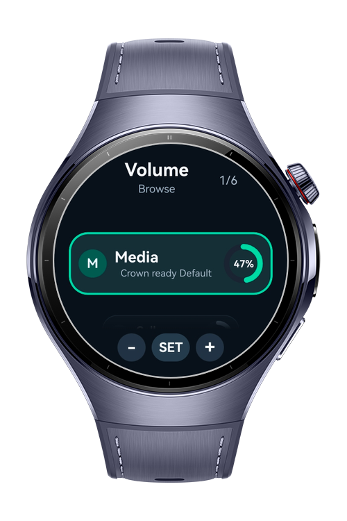
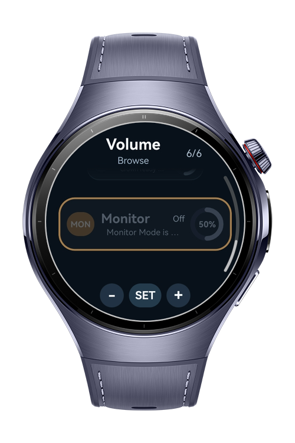
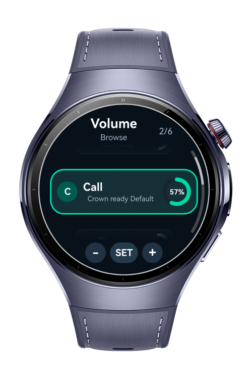
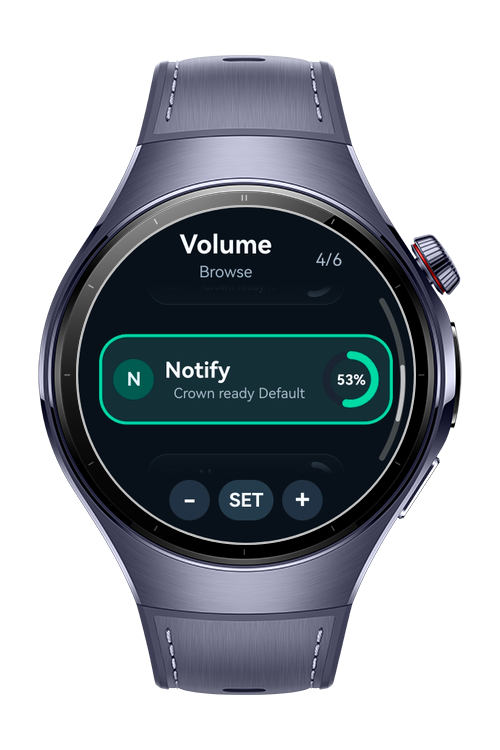

> **Note:** To access all shared projects, get information about environment setup, and view other guides, please visit [Explore-In-HMOS Index](https://github.com/Explore-In-HMOS/hmos-index).

# How To Build Volume Control Center

`How To Build Volume Control Center` is a HarmonyOS smart wearable sample that demonstrates how to build a compact system volume dashboard for watch screens. It lets users browse available audio streams, adjust volume with the crown-style controls or on-screen buttons, view live level changes, and test optional monitor mode when hardware loopback is supported.

# Preview
<p>
   
  
  
  
</p>

# Use Cases

- Watch volume dashboard - Control common system audio streams from one circular wearable UI
- Media volume adjustment - Increase or decrease music and playback volume without opening another app
- Call volume adjustment - Tune voice communication volume during watch-focused workflows
- Ringtone and notification checks - Review ringtone, notification, and alarm levels from separate cards
- Crown-friendly interaction - Browse streams and adjust levels with crown-style step behavior
- Touch fallback controls - Use compact plus, minus, SET, and OK controls when hardware input is not available
- Live system sync - Keep cards updated when volume changes are triggered by the platform or device controls
- Monitor mode testing - Enable hardware audio loopback monitoring on supported devices after microphone permission is granted

# Technology

## Stack
- Languages: ArkTS, ArkUI
- Frameworks: HarmonyOS SDK 6.0.1(21)
- Tools: DevEco Studio Vers 6.0.1
- Libraries
    | Audio APIs  | @kit.AudioKit (AudioManager, AudioVolumeManager, AudioVolumeGroupManager, AudioLoopback) |
    | Ability APIs | @kit.AbilityKit (UIAbilityContext for permission requests)                              |
    | UI APIs      | @kit.ArkUI (ArcList, ArcListItem, circular wearable interactions)                       |

## Required Permissions
The following permissions must be declared in `module.json5`:

- "ohos.permission.MICROPHONE"
- "ohos.permission.ACCESS_NOTIFICATION_POLICY"

# Directory Structure
```
entry/src/main/ets/
|-- entryability/
|   `-- EntryAbility.ets              # App entry and lifecycle setup
|-- entrybackupability/
|   `-- EntryBackupAbility.ets        # Backup extension ability
|-- pages/
|   `-- Index.ets                     # Main circular volume dashboard
|-- components/
|   |-- VolumeCard.ets                # Stream volume card
|   |-- VolumeRing.ets                # Circular progress/level ring
|   |-- MonitorModeCard.ets           # Hardware loopback monitor card
|   `-- SystemVolumePanelHost.ets     # Transient system volume overlay
|-- services/
|   |-- AudioBootstrapService.ets     # Shared audio manager initialization
|   |-- VolumeStateService.ets        # Stream volume loading, refresh, and listeners
|   |-- VolumeGroupService.ets        # Default volume group fallback operations
|   |-- CrownInputController.ets      # Crown/button navigation and step math
|   `-- LoopbackMonitorService.ets    # Optional hardware monitor mode handling
|-- common/
|   |-- Logger.ets                    # HiLog helper
|   |-- PermissionHelper.ets          # Runtime permission request helper
|   `-- VolumeMath.ets                # Clamp and percentage utilities
`-- model/
    |-- VolumeDashboardState.ets      # Dashboard UI state
    |-- VolumeStreamModel.ets         # Audio stream definitions and level model
    `-- LoopbackMonitorState.ets      # Monitor mode state
```

# Constraints and Restrictions

## Supported Device
- Huawei Watch 5 Series
- HarmonyOS Wearable devices with audio volume APIs
- DevEco Studio Simulator (UI flow only; real audio behavior depends on simulator support)

## Technical Constraints
Constraint                     |      Value
-------------------------------------------------------------------
Controllable streams           |      Media, Call, Ringtone, Notification, Alarm
Volume adjustment step         |      1 raw platform volume level
Monitor volume adjustment step |      5 percent
Monitor mode                   |      Requires hardware audio loopback support
Runtime permission             |      Microphone permission is requested before enabling Monitor Mode
System access limitation       |      Some stream setters or callbacks may fall back to default volume group APIs depending on device firmware

# License (MIT)
`How To Build Volume Control Center` is distributed under the terms of the MIT License. See the [LICENSE](./LICENSE) for more information.
